# Unit42-FirmwareX — Architecture

## 1. Pipeline (what runs on every upload)

```mermaid
flowchart LR
    U[User / Dashboard] -->|POST /firmware/upload| API[FastAPI]
    API --> DB[(SQLite\nfirmware, jobs,\nfindings, audit_log)]
    API -->|background task| P[Pipeline Orchestrator]

    subgraph SANDBOX["Isolated sandbox container\n--network none · cap-drop ALL · mem/cpu/pids quotas"]
        direction TB
        UNP[1. Unpack\nbinwalk -> unsquashfs -> sasquatch -> tar] --> AUD[2. Static ELF Audit\nNX / PIE / RELRO / canary / FORTIFY]
        AUD --> LEAD[3. Sink Leads\nstatic import scan: strcpy/system/...]
        LEAD --> ANGR[4. angr Reachability\nbudgeted child process, CFG + source-to-sink]
        ANGR --> SEC[5. Secret / Crypto Scan\nredacted, fingerprint-only]
    end

    P --> SANDBOX
    SEC --> NORM[Normalise to\nFinding schema]
    NORM --> DB
    DB --> REPORT[GET /firmware/id/report]
    REPORT --> DASH[Dashboard\nFindings / Mitigations / Files / Audit log]
```

## 2. Components

| Component | File(s) | Responsibility |
|---|---|---|
| API | `app/main.py` | Upload, status, filesystem/binary-audit/vulnerabilities/report endpoints |
| Orchestrator | `app/pipeline.py` | Runs the 5 stages in order, persists stage timings, enforces the overall time budget |
| Unpacker | `app/unpacker.py` | binwalk → unsquashfs → sasquatch (carve + patched extractor for non-standard SquashFS) → tar fallback; file-tree inventory with SHA-256 |
| Static audit | `app/elf_audit.py` | Per-ELF hardening matrix via pyelftools |
| Sink leads | `app/sinks.py` | Static import scan for dangerous functions, flags network-facing binaries |
| Taint stage | `app/taint_angr.py` | angr CFG recovery + source→sink reachability, run in a separate process with a wall-clock + memory budget |
| Secret scanner | `app/secrets_scan.py` | Pattern + entropy based secret/weak-crypto detection; **redacts on detection** — only a salted SHA-256 fingerprint is ever stored |
| Schema | `app/schema.py` | The `Finding` / `BinaryAudit` data model (Appendix A of the spec) |
| Storage + audit log | `app/db.py` | SQLite store; **hash-chained, append-only audit log** — tampering is detectable |
| Sandbox | `app/sandbox.py` | Builds the `docker run` invocation: `--network none`, `--cap-drop ALL`, `--memory/--cpus/--pids-limit`, `--read-only` root + tmpfs `/tmp` |
| Dashboard | `static/index.html` | Single-page UI; renders firmware content with `textContent` only (never `innerHTML`), since firmware strings are untrusted input |

## 3. Containment design

Every tool that touches an untrusted firmware image (binwalk, unsquashfs, sasquatch, angr) runs inside a container built from `Dockerfile.sandbox`, launched with:

- `--network none` — zero egress, verified: `docker run --rm --network none fwx-sandbox ping -c1 1.1.1.1` → `Network is unreachable`
- `--cap-drop ALL --security-opt no-new-privileges` — no elevated capabilities, including no `CAP_DAC_OVERRIDE` (root inside the container cannot bypass file permissions — this is why the per-job work directory has to be made world-writable before the mount, a fix found by running against a real firmware image and reading the container's own error message)
- `--memory / --cpus / --pids-limit` — a runaway or hostile binary is capped, not just slow
- A wall-clock timeout per stage; on breach the container is `docker kill`ed and the stage is marked `incomplete` rather than silently hanging the job
- `FWX_SANDBOX=local` exists only for development on a machine without Docker, and is written to the audit log as an explicit `WARNING:uncontained_run` so a dev-mode run can never be mistaken for a contained one

## 4. Data flow for one finding

1. Unpack stage extracts the root filesystem and inventories every file.
2. Audit stage produces a `BinaryAudit` row per ELF.
3. Sink-lead and angr stages each produce `Finding` rows — angr's results, where present, supersede the static heuristic for the same `(binary, sink)` pair, since they come with an actual source (`nvram_get`, `fgets`, …) and higher confidence.
4. The secret scanner produces `Finding` rows of category `hardcoded_secret` / `weak_crypto`, with `evidence_ref` holding only a fingerprint, never the raw value.
5. All findings are persisted and served at `GET /firmware/{id}/report`, together with the full audit log and its chain-validity check.

## 5. Known limitations

- Full-system / network emulation (QEMU bringing up a live network service) is not implemented — out of scope for a one-day slice; the PRD itself calls this an open research problem.
- angr's reachability result is a **CFG-based lead** (source and sink appear in the same call chain), not a data-flow proof — `crash_state` is a placeholder until real symbolic execution is added.
- Fuzzing, a CFG visualiser and OpenTelemetry tracing are not implemented (PRD lists these as "Should", not "Must").
- SQLite is used in place of PostgreSQL/Redis/Celery for this scale; the schema maps directly if migrated later.